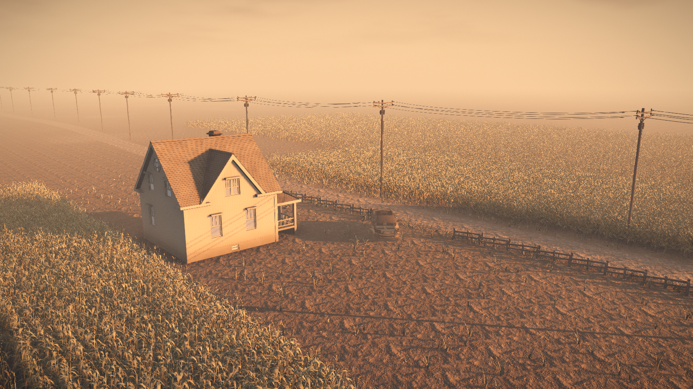

# The Long Tide

*Channel nine. Always channel nine.*

A story-driven, third-person 3D game that runs in the browser. You play Eli Harlan, a farmer and former test pilot, on a dying, dust-choked farm. A strange clicking on his daughter June's homemade radio turns out to be a distress call from Kestrel-2, a deep-space relay he once flew out of the solar system. It's the only thing that can guide humanity's colony ships to a new world, and it's failing.

Built with Three.js and Rapier. It aims for a realistic, cinematic, lived-in look: golden-hour haze, dust on everything, corn that moves in the wind and parts when you drive through it.



## Status

| Level | State |
| --- | --- |
| 1. The Farm | **Playable**: five scenes, about 10 minutes |
| 2. Transit | Story written, text card |
| 3. The Tide World | Story written |
| 4. The Relay | Story written |
| Ending | Story written |

The full story is in [STORY.md](STORY.md). All dialogue lives in [src/story.js](src/story.js).

## Play it

You need [Node.js](https://nodejs.org/) 18 or newer.

```bash
npm install
npx vite
```

Then open http://localhost:5173/ and click **New game**.

| Key | Action |
| --- | --- |
| W A S D | Move |
| Shift | Run |
| Mouse | Look (click the game to capture the mouse) |
| E | Interact, get in or out of the truck |
| Space | Brake / advance dialogue |
| R | Reset the truck if it flips |
| G | Switch between High and Low graphics |
| Esc | Skip a cutscene |

Your progress saves at the start of each scene, and **Continue** on the title screen picks up from there.

### Developer shortcuts

Add these to the address:

- `?scene=1` … `?scene=5` jumps straight to a scene.
- `?q=low` or `?q=high` forces a graphics setting.
- `?view=aerial` (or `yard`, `barn`, `road`, `hills`) opens a free camera over the valley.
- `/lookdev-farm.html` opens the original look-development test scene.

## Level 1: The Farm

1. **Supper on the porch.** A dust warning on the radio, and June's radio picking up a repeating click.
2. **The balloon chase.** Chase a sinking weather balloon across the fields in the truck, straight through the corn, following a signal meter.
3. **The storm and the tape.** A dust storm rolls in. In June's room, line up the balloon's tape log with her radio to decode the message.
4. **The night drive.** Take the payload to a floodlit, half-buried observatory at the edge of the valley.
5. **The goodbye.** June won't look at him. Eli leaves her one of a pair of walkie-talkies on channel 9, then drives away.

## What's in it

**World**
- 400 × 400 m farm valley ringed by hills, built in code: terrain, a road network painted into a mask texture, tyre ruts, furrowed fields.
- About 330,000 corn plants and 66,000 grass clumps, instanced in 32 m tiles with distance level of detail.
- Corn and grass sway in a noise-driven wind shader. They bend away from the truck and the player, and the truck leaves a flattened track that slowly stands back up.

**Look**
- HDRI environment lighting, a low warm sun with soft shadows, and analytic height fog tinted toward the sun.
- A shared material shader adds dust to top surfaces, dirt on lower parts and sun-fading to every model.
- Post-processing on High: N8AO ambient occlusion, bloom, ACES tone mapping, a custom color grade (teal shadows, amber highlights), vignette and SMAA.
- Weather and time of day: golden hour, a dust storm, night with stars, and dusk, with smooth transitions.

**Characters and movement**
- Realistic scanned characters for June, Wes, Ada and Dr. Okafor. June and Ada were unrigged scans, so the build tools fit and bind a skeleton to them automatically.
- A world-space retargeting system plays the same animations on different rigs (Mixamo, RenderPeople, auto-rigged), whether they're in an A-pose or a T-pose.
- Motion-captured walk and an upright jog for the player, speed-matched so the feet don't skate. On top: momentum, leaning into turns, head look and foot placement on uneven ground.

**Vehicle**
- A Rapier ray-cast pickup with suspension, spinning and steering wheels, speed-sensitive steering, headlights, dust plumes from the rear tyres and a chase camera.

**Systems**
- Dialogue box with a typing effect, cutscenes (camera paths, letterbox bars, timed subtitles, optional voice files), trigger zones, an objective HUD, checkpoints, and a time-counter HUD for the later levels.

**Sound**
- All synthesized in WebAudio: wind gusts, footsteps, a diesel-style engine, leaves rustling in the corn, and ambient music pads.

## Project layout

```
src/
  main.js              entry point and render loop
  story.js             every line of dialogue and on-screen text
  core/                renderer and post-processing, physics, input, player, truck, retargeting
  systems/             dialogue, cutscenes, triggers, HUD, audio, save, trample map, time counter
  assets/              code-built assets: terrain, corn, grass, sky, dust, balloon, characters,
                       and the shared dust/fog/wind material shader
  levels/farm/         world layout, atmosphere, bedroom, observatory, puzzle, story script
public/
  models/              optimized .glb models (meshopt + WebP textures)
  textures/ hdri/      Poly Haven PBR textures and HDRIs
tools/                 Playwright scripts for screenshots and scripted play-throughs
docs/lookdev/          look-development screenshots
```

## Tech

- [Three.js](https://threejs.org/) for rendering
- [Rapier](https://rapier.rs/) (`@dimforge/rapier3d-compat`) for physics, the character controller and the vehicle
- [postprocessing](https://github.com/pmndrs/postprocessing) and [N8AO](https://github.com/N8python/n8ao) for post effects
- [Vite](https://vitejs.dev/) for the dev server
- [Playwright](https://playwright.dev/) for automated screenshots and play-throughs
- [Blender](https://www.blender.org/) and [glTF-Transform](https://gltf-transform.dev/) for preparing models (scaling, decimating, rigging, compressing)

Plain JavaScript ES modules, with no framework.

### Testing

With the dev server running, these capture screenshots in the headless browser:

```bash
node tools/shoot.mjs shots lookdev-farm.html corn,road,wide high
node tools/play.mjs shots "scene=2" "wait:2000;;down:KeyW;;wait:1500;;shot:walk"
```

`play.mjs` takes a `;;`-separated list of steps: `wait:ms`, `down:Key`, `up:Key`, `tap:Key`, `shot:name`, `eval:js` and `until:js`.

## Credits

All third-party models, textures and HDRIs are free assets under **CC0** (Poly Haven) or **CC-BY 4.0** (Sketchfab). Every asset, its author, its source link and what was changed is listed in [CREDITS.md](CREDITS.md). CC-BY authors will also appear on the in-game credits screen.

The story, dialogue, shaders, code-built assets and all audio were made for this project.

## Setting up assets yourself

The prepared models are already in `public/models`, so you don't need anything else to play. If you want to fetch more assets from Sketchfab, put your API token in a `.env` file in the project root:

```
SKETCHFAB_TOKEN=your_token_here
```

`.env` is in `.gitignore`, so it is never committed.
