<p align="center">
  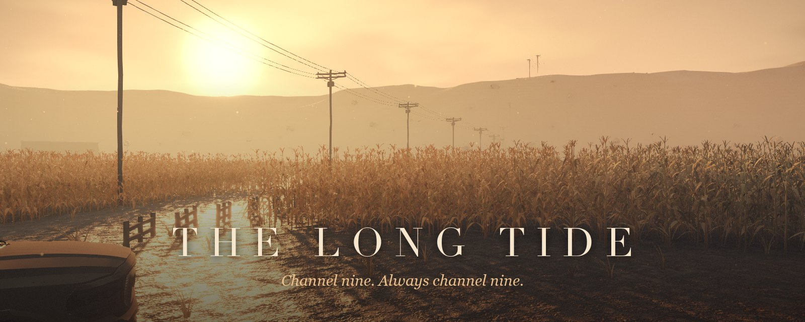
</p>

<p align="center">
  <b>A cinematic, story-driven 3D game that runs in your browser.</b><br>
  <sub>Three.js · Rapier physics · hand-built shaders · about 330,000 plants swaying in the wind</sub>
</p>

<p align="center">
  <a href="#-play-it"></a>
  
  
  
  
</p>

---

<h2 align="center">▶ Watch the demo</h2>

<p align="center">
  <a href="docs/demo.mp4">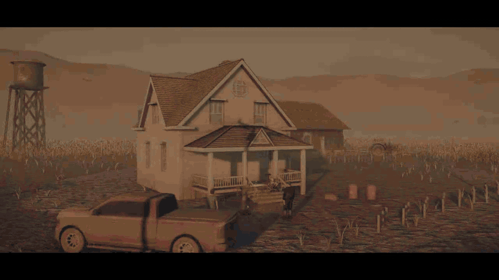</a><br>
  <sub><b><a href="docs/demo.mp4">Click to watch the full 1¾-minute gameplay demo (MP4)</a></b> · recorded live in the browser, nothing pre-rendered</sub>
</p>

---

## The story

The crops are failing. The sky is the colour of rust. On a dust-choked farm at the edge of a dying valley, **Eli Harlan**, a farmer who used to fly test ships, eats supper on the porch because the kitchen is full of grit.

His daughter **June**, ten years old, has built a radio out of salvaged parts. It keeps picking up a slow, repeating click. Three slow, two fast. Every time.

It's a distress call from **Kestrel-2**, a deep-space relay Eli flew out of the solar system eleven years ago. It holds the only route to a new world for humanity's colony ships, and it's dying.

Out there, time runs slow for him and fast for her. The only line between them is a pair of old walkie-talkies, set to **channel nine**.

> *"You said the clicks would still be real tomorrow. You didn't say you'd be gone tomorrow."*

<p align="center">
  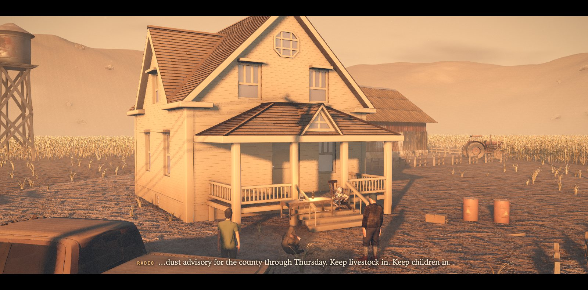
</p>

## Gameplay

<p align="center">
  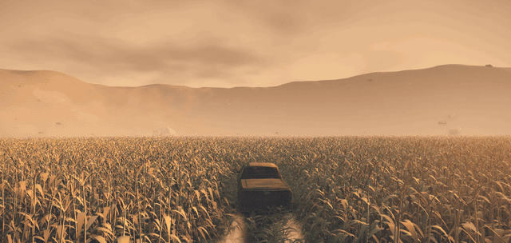<br>
  <sub><i>Drive anywhere. The corn bends away from the truck, stays flattened in its track, and slowly stands back up.</i></sub>
</p>

### Level 1: The Farm (playable, about 10 minutes)

| | |
| :-- | :-- |
| 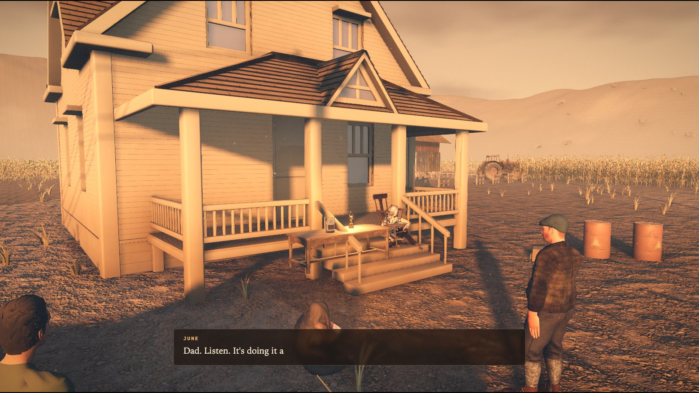 | **1. Supper on the porch.** A dust advisory on the kitchen radio. June swears the clicking means something. Then Wes spots something silver sinking over the east field. |
| 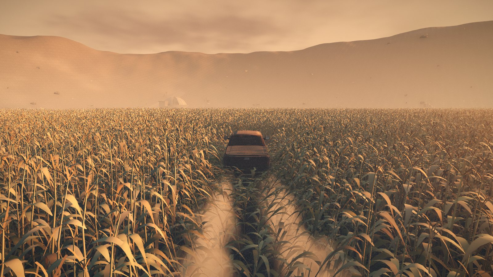 | **2. The balloon chase.** Take the truck and chase a lost weather balloon straight through the corn, following a signal meter on the dash. |
| 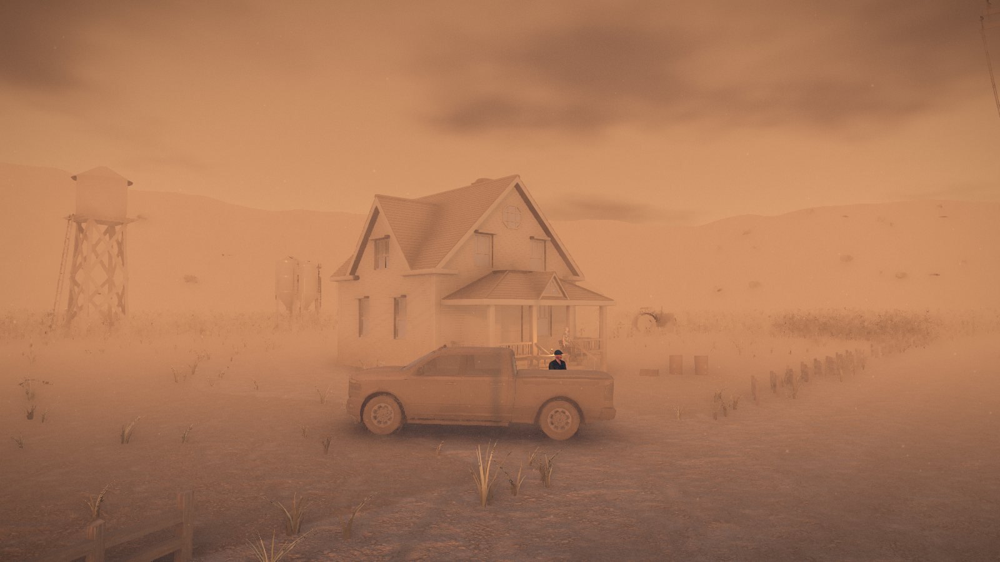 | **3. The storm…** A wall of dust rolls over the farm. Get home before it hits. |
| 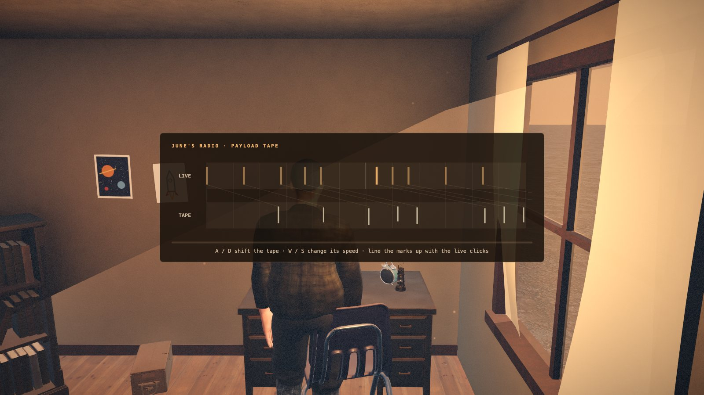 | **…and the tape.** In June's room, line up the balloon's tape log with her live radio until the marks match, and decode the message. |
| 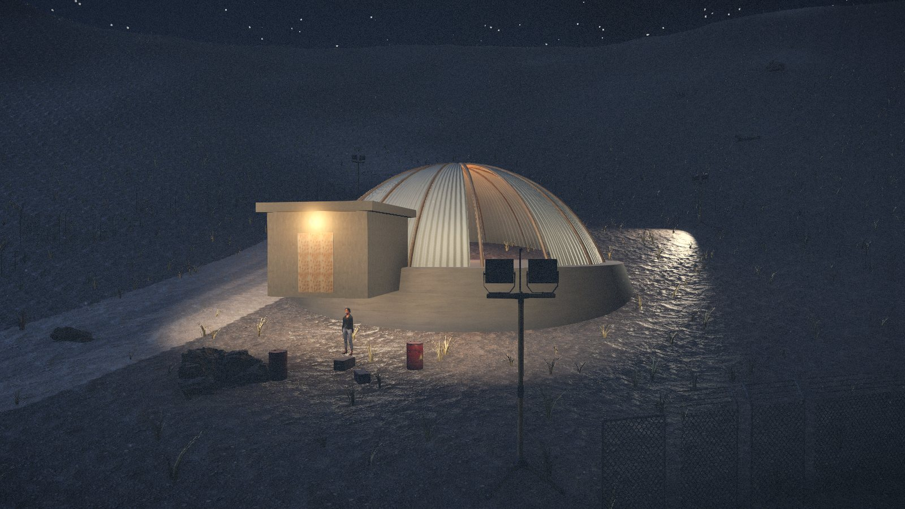 | **4. The night drive.** Headlights, stars, and a floodlit observatory half-buried in the hills, where Dr. Okafor explains what Kestrel's death will cost. |
| 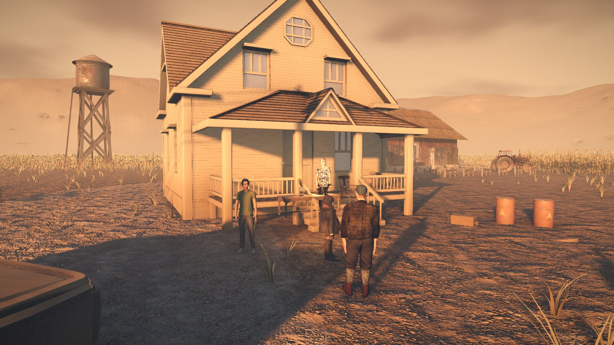 | **5. The goodbye.** June won't look at him. Eli leaves one walkie-talkie on her bookshelf and keeps the other. |

### Still to come

| Level | |
| :-- | :-- |
| **Transit** | Two years of sleep, and a slingshot around Jupiter into the outer dark. |
| **The Tide World** | A shallow ocean moon where every hour costs five years at home. A surge on the horizon. Twenty years of messages from June in one sitting. |
| **The Relay** | A zero-g repair of the dying beacon, with June, now an engineer, talking him through it across a four-minute radio lag. |
| **Ending** | A green valley, decades later. An old woman on a rebuilt porch, a walkie-talkie in her lap. |

The full story is in [STORY.md](STORY.md). Every line of dialogue is in [src/story.js](src/story.js).

## The world

<p align="center">
  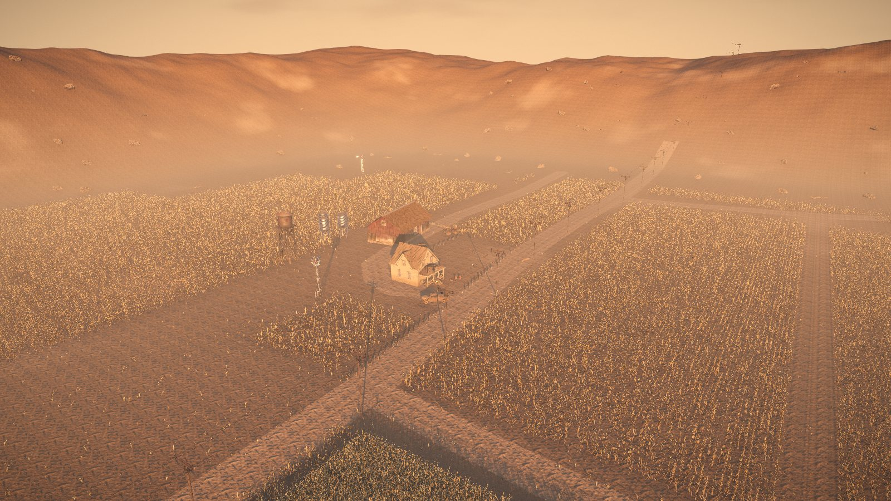<br>
  <sub><i>A 400 × 400 m valley, built in code and fully explorable on foot or by truck.</i></sub>
</p>

<table>
<tr>
<td width="50%" valign="top">

**🌾 Living landscape**
- About 330,000 corn plants and 66,000 grass clumps, instanced in tiles with distance level of detail
- A noise-driven wind shader with gusts and a different sway per plant
- Plants are pushed aside by the truck and the player, and stay trampled in the truck's track
- Procedural terrain, a road network with tyre ruts, and furrowed fields

**🎥 Cinematic look**
- HDRI lighting and a low, warm sun with soft shadows
- Analytic height fog that glows toward the sun
- N8AO ambient occlusion, bloom, ACES tone mapping, a custom teal-and-amber color grade, vignette and SMAA
- Golden hour, dust storm, dusk and a starry night, with smooth transitions

</td>
<td width="50%" valign="top">

**🧍 Characters and movement**
- Realistic scanned characters with faces. Unrigged scans get a skeleton fitted automatically
- A world-space retargeting system that plays one animation set across different rigs
- Motion-captured walking, speed-matched so the feet never skate, plus momentum, leaning into turns and foot placement on uneven ground

**🛻 The truck**
- A Rapier ray-cast vehicle with suspension, steering and spinning wheels
- Dust plumes, headlights, a chase camera and drag when ploughing through corn

**🔊 Sound**
- All synthesized live: wind gusts, footsteps, a diesel engine and leaves rustling in the corn

</td>
</tr>
</table>

<p align="center">
  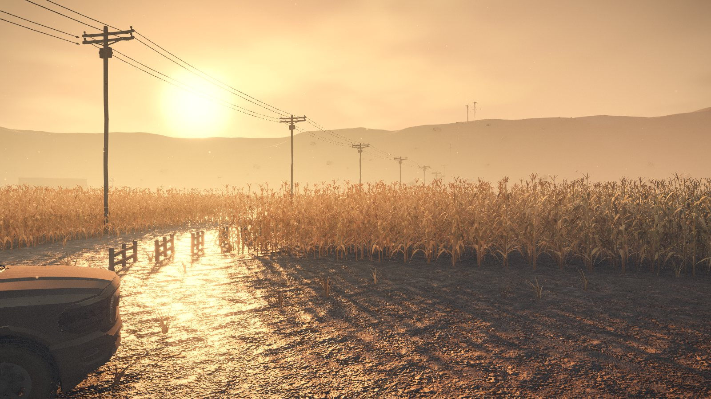
</p>

## 🎮 Play it

You need [Node.js](https://nodejs.org/) 18 or newer.

```bash
git clone https://github.com/asil-eng/the-long-tide.git
cd the-long-tide
npm install
npx vite
```

Open **http://localhost:5173/** and click **New game**. Your progress saves at the start of each scene, and **Continue** picks up where you left off.

<p align="center">
  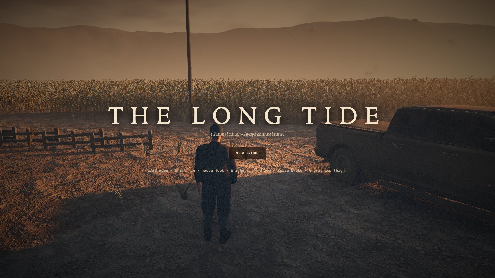
</p>

| Key | Action |
| :-: | :-- |
| <kbd>W</kbd> <kbd>A</kbd> <kbd>S</kbd> <kbd>D</kbd> | Move |
| <kbd>Shift</kbd> | Run |
| <kbd>Mouse</kbd> | Look (click the game to capture the mouse) |
| <kbd>E</kbd> | Interact, get in or out of the truck |
| <kbd>Space</kbd> | Brake, advance dialogue |
| <kbd>R</kbd> | Reset the truck |
| <kbd>G</kbd> | Switch between High and Low graphics |
| <kbd>Esc</kbd> | Skip a cutscene |

<details>
<summary><b>Developer shortcuts</b></summary>

Add these to the address:

| Parameter | Does |
| :-- | :-- |
| `?scene=1` … `?scene=5` | Jump straight to a Farm scene |
| `?q=low` / `?q=high` | Force a graphics setting |
| `?view=aerial` (or `yard`, `barn`, `road`, `hills`) | Free camera over the valley |
| `/lookdev-farm.html` | The original look-development test scene |

</details>

<details>
<summary><b>Automated screenshots and play-throughs</b></summary>

With the dev server running:

```bash
node tools/shoot.mjs shots lookdev-farm.html corn,road,wide high
node tools/play.mjs shots "scene=2" "wait:2000;;down:KeyW;;wait:1500;;shot:walk"
```

`play.mjs` takes a `;;`-separated list of steps: `wait:ms`, `down:Key`, `up:Key`, `tap:Key`, `shot:name`, `eval:js` and `until:js`. It prints the fps at each shot and any console errors.

</details>

## Under the hood

```
src/
├── main.js             entry point and render loop
├── story.js            every line of dialogue and on-screen text
├── core/               renderer and post-processing, physics, input, player, truck, retargeting
├── systems/            dialogue, cutscenes, triggers, HUD, audio, save, trample map, time counter
├── assets/             code-built assets: terrain, corn, grass, sky, dust, balloon, characters,
│                       and the shared dust / fog / wind material shader
└── levels/farm/        world layout, atmosphere, bedroom, observatory, tape puzzle, story script
public/                 optimized models (meshopt + WebP), Poly Haven textures and HDRIs
tools/                  Playwright tools, plus the Blender asset pipeline (prep, auto-rig, cleanup)
```

**Built with** [Three.js](https://threejs.org/) · [Rapier](https://rapier.rs/) · [postprocessing](https://github.com/pmndrs/postprocessing) · [N8AO](https://github.com/N8python/n8ao) · [Vite](https://vitejs.dev/) · [Playwright](https://playwright.dev/) · [Blender](https://www.blender.org/) · [glTF-Transform](https://gltf-transform.dev/)

Plain JavaScript ES modules, with no framework.

Contributing or picking up the remaining levels? Start with [AGENTS.md](AGENTS.md) for the full code map and roadmap, and [CLAUDE.md](CLAUDE.md) for the art direction.

## Credits

All third-party models, textures and HDRIs are free assets under **CC0** ([Poly Haven](https://polyhaven.com/)) or **CC-BY 4.0** ([Sketchfab](https://sketchfab.com/)). Every asset, its author, its source and what was changed is listed in **[CREDITS.md](CREDITS.md)**.

The story, dialogue, shaders, code-built assets and all audio were made for this project.

<details>
<summary><b>Fetching more assets</b></summary>

The prepared models are already in `public/models`, so you don't need anything else to play. To download more from Sketchfab, put your API token in a `.env` file in the project root:

```
SKETCHFAB_TOKEN=your_token_here
```

`.env` is in `.gitignore`, so it is never committed.

</details>

<p align="center"><br><i>Channel nine. Always channel nine.</i></p>
